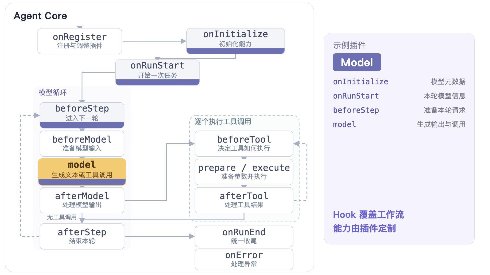

# QuiFox

[English](README.md) | 简体中文

> **实验性研究项目。** 用小型执行内核与显式插件探索不同的 Agent 组合。API 与组合契约仍在演进；项目尚未建立生产就绪的保证。

<p align="center">
  <strong>通过开放的钩子系统，自由组合你的 Agent 行为。</strong>
</p>

## Agent 框架

QuiFox 提供默认执行循环与覆盖生命周期的 Hook。插件提供模型生成、会话、提示词、工具、中断、恢复、压缩、事件、子任务与团队能力。

可变 Context 与 Hook 工作数据给插件作者更多探索空间；插件之间的协作依赖共同能力、顺序与生命周期契约。

## QuiFox 应用

**[QuiFox TUI 与桌面端](quifox/)** 基于共享 runtime 提供可交互的应用。[中文应用指南](quifox/README.zh-CN.md) 统一说明终端安装、源码启动与模型配置。

## 设计演示

从生命周期 Hook 出发，展示会话、中断与恢复、插件组合、运行追踪、Code Mode 与平级 Agent 协作，并通过应用示例说明这些能力如何组合使用。

[](docs/media/agent-core-demo.mp4)

[观看 QuiFox Core 与插件能力展示](docs/media/agent-core-demo.mp4)。

## 探索插件组合

- 通过 Chat 或 Responses 会话保留对话历史。
- 组合中断、检查点与运行中追加输入。
- 多个平级普通 Agent 共享 Teams 插件。
- 使用宿主提供的代码执行器，重新组合插件集合。

## 从源码开始

使用根 manifest 固定版本的 Bun，在仓库根目录安装并构建 workspace：

```sh
bun install --frozen-lockfile
bun run build
```

### DeepSeek Chat 示例

Bun 宿主可以把 Chat 会话与模型生成组合为一个对话插件。示例通过 Chat Completions 调用 DeepSeek 的 `deepseek-flash` 模型（[官方模型文档](https://api-docs.deepseek.com/quick_start/pricing/)）。

这只是插件组合的一种实现示例。开发者可以自行实现和组合插件，构建更丰富的能力与不同的 Agent 行为。

在仓库根目录运行以下 JavaScript。宿主通过环境变量提供 `DEEPSEEK_API_KEY`。

```js
import { createAgent } from '@quifox/agent-core'
import { ChatModelPlugin } from '@quifox/agent-plugin-model'
import { ChatSessionPlugin, ChatConversationPlugin } from '@quifox/agent-plugin-session'

const session = new ChatSessionPlugin({ id: 'example', ownerId: 'example' })
const generation = new ChatModelPlugin({
    session,
    model: 'deepseek-flash',
    baseUrl: 'https://api.deepseek.com',
    apiKey: process.env.DEEPSEEK_API_KEY,
    assistantReasoningField: 'reasoning_content'
})
const conversation = new ChatConversationPlugin({ session, generation })
const agent = createAgent({ plugins: [conversation] })
const outcome = await agent.run({ prompt: 'Reply with exactly "Hello World".' })
if (!outcome.ok) { throw outcome.error }
console.log(conversation.readOutput())
```

## 包

| 包 | 职责 |
| --- | --- |
| [agent-core](packages/agent-core/README.zh-CN.md) | 默认循环、Hook、Context、Outcome 与 Tool 合同 |
| [agent-plugin-model](packages/agent-plugin-model/README.zh-CN.md) | 模型生成钩子及内部协议、传输适配 |
| [agent-plugin-session](packages/agent-plugin-session/README.zh-CN.md) | Chat 历史、存储、Fork 与 Conversation 组合 |
| [agent-plugin-compaction](packages/agent-plugin-compaction/README.zh-CN.md) | 上下文预算、摘要与检查点 |
| [agent-plugin-checkpoint](packages/agent-plugin-checkpoint/README.zh-CN.md) | 当前轮执行记录与恢复数据 |
| [agent-plugin-interrupt](packages/agent-plugin-interrupt/README.zh-CN.md) | 协作暂停与终止策略 |
| [agent-plugin-steering](packages/agent-plugin-steering/README.zh-CN.md) | 输入合批与运行交接 |
| [agent-plugin-code-mode](packages/agent-plugin-code-mode/README.zh-CN.md) | 宿主代码执行与异步 Tool 代理 |
| [agent-plugin-composition](packages/agent-plugin-composition/README.zh-CN.md) | 插件数组提案与新 Agent 引用交接 |
| [agent-plugin-tools](packages/agent-plugin-tools/README.zh-CN.md) | 工具目录、可见性与入口路由 |
| [agent-plugin-system-prompt](packages/agent-plugin-system-prompt/README.zh-CN.md) | 调用方提供的可信提示词贡献 |
| [agent-plugin-subagents](packages/agent-plugin-subagents/README.zh-CN.md) | 子 Agent、fork、消息、等待与停止 |
| [agent-plugin-tasks](packages/agent-plugin-tasks/README.zh-CN.md) | 后台操作与真实任务回执 |
| [agent-plugin-project-context](packages/agent-plugin-project-context/README.zh-CN.md) | 标准 Skills 与作用域 AGENTS.md |
| [agent-plugin-request-context](packages/agent-plugin-request-context/README.zh-CN.md) | 与原文分离的临时模型上下文 |
| [agent-plugin-memory](packages/agent-plugin-memory/README.zh-CN.md) | 两阶段记忆与来源核验 |
| [agent-plugin-teams](packages/agent-plugin-teams/README.zh-CN.md) | 平级成员信箱与唤醒调度 |
| [agent-plugin-events](packages/agent-plugin-events/README.zh-CN.md) | 单 Agent 执行观察 |
| [agent-plugin-formal-backend](packages/agent-plugin-formal-backend/README.zh-CN.md) | Responses 后端的参考组合 |

## 示例与延伸阅读

- [QuiFox TUI](quifox/tui/README.zh-CN.md)：狐狸终端宿主，提供流式聊天、审批与恢复。
- [QuiFox Desktop](quifox/desktop/README.zh-CN.md)：Tauri/React 工作目录、子会话与可展开执行轨迹。
- [共享运行时](quifox/runtime/README.zh-CN.md)：通用 Bun Host、配置、归档与插件装配。
- [团队工作台](examples/teams-web/README.zh-CN.md)：平级 Agent 协作、独立事件流与邮箱投递。
- [插件开发指南](docs/guides/plugin-authoring.zh-CN.md)。
- [架构解读](docs/guides/architecture.zh-CN.md)。
- [路线图](ROADMAP.md)。

## 相关项目

QuiFox 围绕最小执行内核，通过生命周期钩子组装能力。[DeepSeek Harness（DSH）](https://github.com/deepseek-ai/deepseek-harness) 同样探索可组合的插件化 Agent 系统，其插件体系基于 Cordis 构建。
