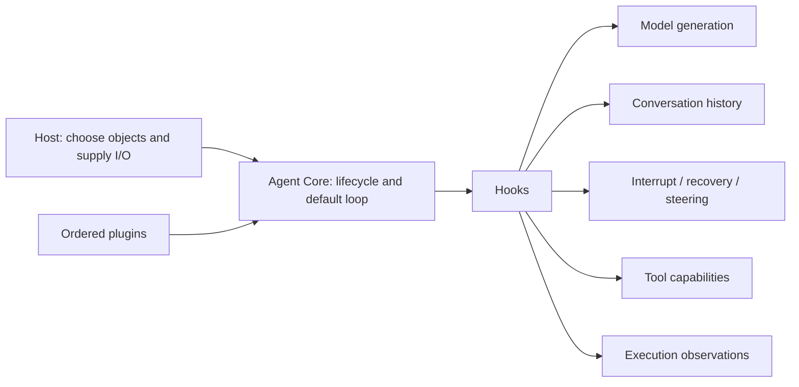

# How Agent Core and plugins fit together

English | [简体中文](architecture.zh-CN.md)

Agent Core is an experimental execution kernel. You assemble an Agent from ordered plugin objects; each plugin contributes a capability through lifecycle Hooks.

## A small kernel, explicit capabilities

Core registers plugins, initializes the Agent, and dispatches Hooks. Its default loop generates a model turn, executes requested Tools serially, and repeats while that turn has Tool calls. Tools own their prepare and execute methods, business results, and side effects.

Model plugins own request projection and protocol parsing. Session plugins own conversation history. Policies such as interruption, checkpoints, input steering, and compaction are selected as plugins. The Host supplies network access, storage, authentication, and application UI.

The [Chat example](../../README.md#deepseek-chat-example) creates Session and Model objects, then registers their Conversation composition. The components retain separate responsibilities while the caller registers one plugin.

## State and ordering

An Agent keeps one Context throughout its lifetime. Each run or stream call has its own Outcome; run consumes the same execution stream that stream exposes. A successful Outcome means the execution chain finished without an unrecovered exception. The returned value and business completion belong to the selected capability.

Hooks see shared mutable working data in array order. A later transformation does not rewrite a result already stored by an earlier plugin. A composition must therefore state which objects it uses, when they read or change data, and how they admit and release a call.

This freedom is useful for experimentation, but implementing the same plugin interface does not make arbitrary plugins compatible. The [authoring guide](plugin-authoring.md) explains concrete ordering, lifecycle, and recovery pitfalls.

## Ordinary Agents can cooperate

The [Teams plugin](../../packages/agent-plugin-teams/README.md) shares a roster and mailboxes across any number of peer Agents. Each member retains its own conversation, model, prompts, and Tools. You can call any member through its ordinary run or stream entry.

Sending a message can wake an idle member. A member returning does not end the team or complete a business goal. Prompts and explicit message exchange define how the application coordinates results.

## Recompose without enlarging Core

[Code Mode](../../packages/agent-plugin-code-mode/README.md) lets a Host-supplied executor use Tool capabilities. [Composition](../../packages/agent-plugin-composition/README.md) accepts a new ordered plugin set and hands a new Agent reference to the Host after cleanup. Applications choose how to hold that reference and release their resources.

Alternative orchestration remains an experiment: plugins can finish an operation at onRunStart and stop before the default loop. Context exposes Tools and plugin objects; it does not expose the internal Hook dispatcher. Reusing operations still requires an explicit collaboration contract.
