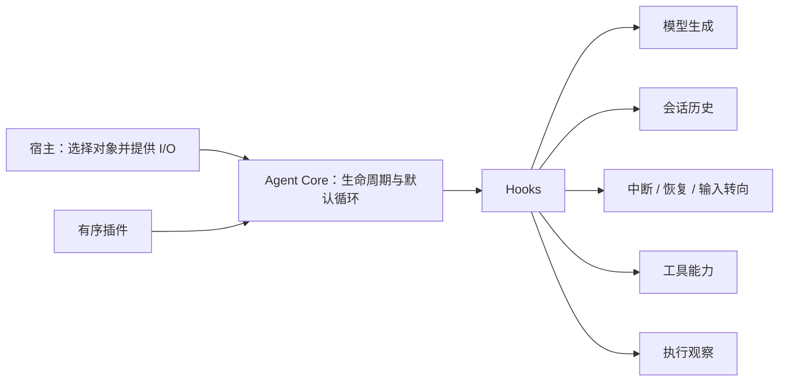

# Agent Core 与插件如何组合

[English](architecture.md) | 简体中文

Agent Core 是实验性执行内核。调用方用有序插件对象组装 Agent，各插件通过生命周期 Hook 提供具体能力。

## 小型内核，显式能力

Core 注册插件、初始化 Agent，并调度 Hook。默认循环先生成一个模型轮，串行执行其工具调用，再根据是否存在工具调用决定继续。工具拥有自己的 prepare、execute、业务结果与副作用。

模型插件拥有请求投影与协议解析，会话插件拥有历史。中断、检查点、输入转向与压缩等策略由调用方选择插件提供。宿主提供网络、存储、认证与应用 UI。

[Chat 示例](../../README.zh-CN.md#deepseek-chat-示例) 创建 Session 与 Model 对象，再注册它们的 Conversation 组合。组件保留各自职责，调用方注册一个组合插件。

## 状态与顺序

同一 Agent 在生命周期内保留一个 Context；每次 run 或 stream 调用有独立 Outcome。run 完整消费的就是 stream 暴露的同一执行流。成功 Outcome 表示执行链没有未恢复异常；具体返回产物与业务完成由所选能力定义。

Hook 按数组顺序读取共享可变数据。后置改写不会追溯修改前置插件已保存的结果。因此，组合需要说明使用哪些对象、何时读取或改写数据，以及如何接纳和释放一次调用。

这种自由便于实验，但实现同一插件接口并不意味着任意插件兼容。[开发指南](plugin-authoring.zh-CN.md) 说明顺序、生命周期与恢复中的具体陷阱。

## 普通 Agent 也能协作

[Teams 插件](../../packages/agent-plugin-teams/README.zh-CN.md) 在任意数量的平级 Agent 之间共享成员表与信箱。每名成员保留自己的会话、模型、提示词和工具；调用方可以通过原有 run 或 stream 入口调用任意成员。

发送消息可以唤醒空闲成员。一个成员返回不代表团队结束或业务目标完成；提示词和显式通信决定应用如何协调结果。

## 通过组合扩展能力

[Code Mode](../../packages/agent-plugin-code-mode/README.zh-CN.md) 让宿主提供的执行器复用工具能力。[Composition](../../packages/agent-plugin-composition/README.zh-CN.md) 接纳新的有序插件集合，在收尾后向宿主交接新 Agent 引用。应用决定如何保存引用并释放自己的资源。

替代编排仍属于实验：插件可以在 onRunStart 完成操作，并在默认循环前停止。Context 暴露工具和插件对象，不暴露内部 Hook 调度器；复用操作仍需明确协作契约。
