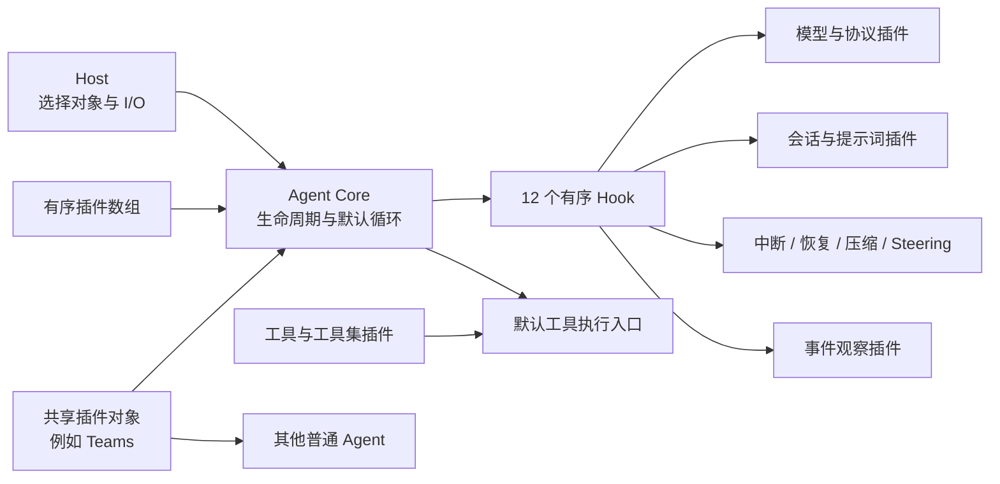

# QuiFox 架构与设计原则

> 类型：跨包长期架构规范。本文定义整个 Agent Monorepo 的设计理念、职责边界和组合不变量。具体生命周期、协议与失败语义由各 owner 的模块 SPEC 定义；源码、测试和运行结果证明当前实现状态。

## 定位

本框架的基本单位不是一个预装全部能力的“大 Agent”，而是一个最小 Core 与一组显式插件对象：

```text
Agent = Agent Core + 有序插件数组
```

Core 提供稳定的执行骨架。模型、会话、提示词、工具集、中断、恢复、压缩、事件、子任务、团队协作和具体 I/O 都由插件或宿主提供。调用方通过组合对象得到所需 Agent，不通过修改 Core 增加产品能力。

同一个 Core 可以用于单轮生成、带历史会话、可中断执行、断点续跑、运行中追加输入、多 Agent 团队或应用专属工具集。这些能力共享 Core 的生命周期和默认执行链，但不因此成为 Core 的固定状态。

## 实验性与契约取舍

当前框架处于实验阶段，公开 API 和官方插件合同在 1.0 前仍可能调整。Core 只校验最小编排不变量，Context 和 Hook 工作对象保持开放、共享、可扩展；这让调用方能够快速组合新能力，也意味着任意两个插件不会仅因都实现 `AgentPlugin` 就自动兼容。

插件自由与协作契约分属两个层面。Core 保留自身执行所需的最小机制合同，不额外规定所有插件必须采用同一套 Model、Session、Memory 或 Context 能力接口。开发者可以组织不同插件集，为它们选择不同的接口、数据格式与协作方式。

同一套需要合作的插件，应明确它们自己的能力接口、对象身份、数组顺序、状态生命周期和失败语义，并由相关 owner SPEC 保存约定。偏离这些约定是开发者拥有的自由，但不能继续假定该插件集兼容；协调困难由实际组合方处理，不因此要求 Core 增加全局强制接口或兼容层。开源示例展示可验证组合，不承诺覆盖所有协议、并发和持久化场景。

Context 同样是开放的共享工作对象。字段、能力、读写方式与共享规则由参与协作的插件集定义；这套约定不成为 Core 固定状态或所有插件通用的 Context Schema。复用同一能力时，组合方需要了解其 owner 与约定，不能从字段名或插件名称自行推断兼容性。

## 架构模型



该图表达 owner 与调用方向，不表示 Core 依赖这些具体插件。只有最终插件数组中的对象参与当前 Agent。

## 职责边界

| Owner | 必须负责 | 不负责 |
|---|---|---|
| Agent Core | 插件注册与一次初始化、长期 Context、每次调用 Outcome、有序 Hook 调度、默认 ReAct `while`、串行工具 `for`、统一错误与 `finally` 收尾 | 消息历史、模型请求、产品提示词、并发接纳、业务中断、恢复策略、团队完成条件、UI 与持久化 |
| 插件 | 自己能力的状态、Hook、组合契约、失败语义和必要 Context 扩展；公开工具对象的调用编排 | 把直接方法调用伪称为已经经过 Core 钩子链；替其他 owner 保存第二份权威状态 |
| Tool | 自己的 `prepare`、`execute`、参数与业务反馈、副作用语义 | Agent 生命周期、模型消息、会话历史和插件排序 |
| Host | 选择插件对象和顺序、注入网络/存储/认证、消费事件、呈现 UI、保留应用安全边界 | 伪造 Core、Tool 或插件已经产生的执行事实 |

包与仓库归属见 [包与仓库边界](packages.md)。

## 设计原则

### 1. 最小 Core，能力插件化

只有所有 Agent 都必须共享、并且无法由现有 Hook 或默认工具入口表达的机制才进入 Core。能够由插件维护的接纳、计步、中断、恢复、事件、消息、提示词或团队状态，不在 Core 增加 `if` 分支或固定字段。

判断一个职责是否越界时，先问三个问题：

1. 它是否是默认循环正确运行所必需的事实？
2. 它是否可以由某个 Hook owner 独立维护？
3. 删除该能力后，其他插件是否仍能使用 Core？

后两个问题为是时，该职责通常属于插件。

### 2. 显式组合，不提供隐式默认

Core 不按插件名称推断能力，也不自动安装 Model、Session、Interrupt、Events 或其他默认插件。缺少必要能力时明确失败；不同协议或策略通过替换插件对象完成。

插件也可以由其他插件构造为一个新的普通插件。组合对象负责委托内部 Hook、保持必要顺序并对外暴露一份能力；Core 不识别“组合插件”这一特殊类别，也不递归复制未知对象图。

本项目的插件开发优先组合独立能力：需要协作时，由显式组合注入该插件集的小接口与对象，不在一个能力插件中直接依赖、安装另一个插件实现。工具保持独立职责；复杂任务由能力和工具组合完成。不同模型供应商分别提供 Model 插件，在所选插件集内约定生成结果、事件与元数据；这不要求把所有供应商收敛成一个 Model 插件，也不禁止其他插件集选择不同的协作接口。

### 3. 默认执行链与工具复用

- `run()` 完整消费 `stream()`，两者不维护两套行为。
- 默认循环消费模型插件产生的工具调用，经 Core 的串行工具链执行。
- Core 工具循环经过同一个 Registry 与执行入口。插件可从同一注册表读取原 Tool 对象，直接调用其 prepare/execute；这种能力复用不自动产生 Core 的钩子、事件或运行事实，调用编排归实际插件。不得通过复制注册表或另建执行器伪造另一份执行事实。
- Session、Checkpoint、Events 与 UI 按各自合同观察执行事实，不各自推断一套“已执行”状态。插件自行编排原 Tool 时，必须明确哪些 Hook、回执和观察能力参与；例如 Code Mode 的代理合同由该包定义。

同一真实调用的副作用与回执仍以执行 owner 为准；直接方法复用不自动获得默认循环的观察与恢复保证。

### 4. 状态跟随真实 owner

状态按生命周期分层：

- **Agent 生命周期**：同一 Agent 长期复用一份 Context、最终插件对象和工具注册表。
- **单次调用**：每次 `run/stream` 使用独立 Outcome；插件用 Outcome 身份关联接纳、错误和收尾。
- **会话历史**：由 Session 或具体后端插件拥有，不进入 Core Context。
- **工具执行记录**：由 Checkpoint 等执行记录插件拥有；缺少回执不自动等于未执行。
- **应用与传输状态**：由 Host、后端或 UI owner 拥有，不通过事件反向修改业务事实。

不使用 Context 对象身份冒充 Run 身份，也不为方便展示复制第二份权威状态。

### 5. 对象身份与数组顺序具有语义

插件对象保持共享可变语义。同一个对象可以在组合中保存协作状态，也可以被多个普通 Agent 显式共享，例如 TeamsPlugin。需要隔离时，调用方创建新对象；Core 不自动深复制或冻结插件内部状态。

最终插件数组是唯一执行顺序。同一 Hook 点依次执行，前一个处理器的原地修改对后一个可见。`onRegister` 可以修改候选数组；运行阶段按已装配的顺序执行。

### 6. 协作合同属于插件集

公开能力、Context 扩展、对象引用、工具 metadata 或组合函数都可以表达协作约定；具体形式由插件集选择。Core 不识别 Chat、Responses、Teams 等具体协议或能力名称，也不因为某个 ID 出现就改变循环。

需要可替换和可靠协作时，参与方遵守所选插件集的能力合同。允许其他合同或不参与该约定，不等于任意插件无需适配即可互换；本项目推荐组合的合同也不是第三方插件的全局准入限制。

### 7. 在最小边界做校验

Core 只校验维护编排不变量所需的内容，例如 Hook 控制决定、工具调用 ID 和必要执行入口。模型完整字段、业务 ToolResult 内容、消息协议和供应商结束原因由实际 owner 校验。

过早校验会阻止后续 Hook 合法改写，也会把某个插件的协议误升为 Core 协议。需要更严格策略时，优先增加显式插件或在具体工具/协议适配器中实现。

### 8. 错误由产生边界决定

工具自行决定返回可供模型处理的 `ToolResult`，还是抛出异常终止本次运行。Core 不猜测工具内部失败，也不把抛出的异常伪装成模型可处理的 ToolResult；未恢复异常规范化为 `AgentError` 后进入 Outcome。

未恢复的 Model、Tool、Hook 或初始化错误进入统一 Outcome；`onError` 观察主错误，`onRunEnd` 在 `finally` 中完成所有必要收尾。附加观察和收尾错误不能覆盖原始主错误。

业务暂停、中断和恢复由显式插件表达。消费者关闭事件流只表示传输未完整消费，不自动等于业务中断或可恢复检查点。

### 9. 观察与控制分离

Events 插件可以记录 Step、Model、Tool、错误和运行收尾，但观察失败不应改变业务执行。SSE、数据库日志和 UI 展示位于 Host 边界；Core 只转发插件事件和少量不可缺失的执行事实。

追踪插件需要覆盖所有 Hook 时，可以在注册阶段围绕最终插件数组插入自身对象；这仍遵守对象身份和数组顺序，不要求 Core 增加追踪专用分支。

### 10. 默认循环可绕过，但不是通用工作流引擎

Core 保留一个直接可读的 Hook-driven ReAct `while` 与串行工具 `for`。插件可以在 `onRunStart` 完成自有流程并返回 `stop`，从而不进入默认循环。

自有流程可以引用其他插件公开能力或编排普通 Agent；能力复用按对应合同实现。公共 Context 声明 tools/plugins，HookRunner 是内部实现；自有流程的能力调用由插件公开接口表达。`afterStep.continue` 的行为遵守默认循环合同。

### 11. 长任务不附加默认执行预算

Core 与本项目推荐的通用组合不默认设置最大模型步骤数、运行总时长或任务总 Token 预算，不把这些限制作为“成熟框架”的必备能力。运行可以持续到模型、工具、业务策略自然结束，或用户主动停止；有明确应用需求时再由可选策略或应用层选择限制。

模型上下文窗口、单次输出上限与压缩触发条件是模型请求容量边界；具体 I/O 超时、取消和安全重试是外部操作边界。它们分别由相应能力处理，不转换为整个 Agent 长任务的统一步数或时间上限。

## 典型组合如何验证理念

- **Session 与 Model**：会话保存历史，模型插件负责协议请求；Chat 与 Responses 可以有不同状态模型，而 Core 不改变。
- **Interrupt、Checkpoint 与 Steering**：停止策略、执行记录和新输入排队分别拥有状态，通过公开契约组合；Core 不增加 `active`、`interrupted` 或恢复分支。
- **Teams**：多个平级 Agent 共享同一个 TeamsPlugin 对象，各自保留独立会话、模型与其他插件；调用任意成员仍使用原 `run/stream`。
- **应用工具集**：应用插件可以同时注册工具集并贡献环境提示词；实际业务运行时与依赖留在应用仓库。
- **Code Mode 与 Composition**：Host 注入代码执行器，Code Mode 复用原 Tool 并构造真实插件对象；Composition 在最后的 `onRunEnd` 创建新 Agent，再通过 Host 回调替换引用。当前循环与 Hook 调度不需要增加动态安装接口。

这些组合是边界验证样例，不把任何一个具体插件升级为所有 Agent 的默认能力。

## 官方推荐组合

推荐组合应明确所用能力、对象引用、候选数组顺序、初始化与收尾时机，以及允许的共享方式。组合对象可以集中配对已有组件；对外仍遵守普通插件与 Agent 合同，不改变 Core 的执行规则。

每份推荐组合须链接各 owner SPEC 与真实 Core 组合测试。支持范围按测试与实际合同说明，不能从单个插件的接口形状推导任意组合兼容。开发方法和常见陷阱见 [插件开发指南](../guides/plugin-authoring.zh-CN.md#推荐组合与协作原则)。

## Non-goals

- 不提供内置 Memory、模型连接、权限、预算、最大步数、持久化或 UI。
- 不提供动态运行期插件安装、自动依赖排序或通用工作流 DSL。
- 不通过 Core 定义团队层级、团队完成条件或后台任务调度。
- 不把演示动画、面试叙事或特定页面布局写成运行时合同。

## SPEC 路由

- Core 生命周期、Hook、Outcome 与默认循环：[`packages/agent-core/docs/specs/architecture.md`](../../packages/agent-core/docs/specs/architecture.md)
- 插件注册、初始化、对象复用与 Session 边界：[`packages/agent-core/docs/specs/sessions.md`](../../packages/agent-core/docs/specs/sessions.md)
- Tool、Registry、prepare/execute 与执行事实：[`packages/agent-core/docs/specs/tool-runtime.md`](../../packages/agent-core/docs/specs/tool-runtime.md)
- 各插件的状态、失败和组合契约：对应 `packages/agent-plugin-*/docs/specs/architecture.md`
- 模型插件：[`packages/agent-plugin-model/docs/specs/architecture.md`](../../packages/agent-plugin-model/docs/specs/architecture.md)
