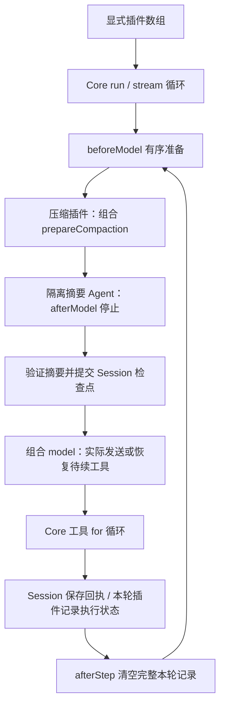

# Chat 会话、生成与组合插件

`ChatSessionPlugin` 是只维护消息、存储与 Fork 的普通插件。生成插件另行实现 model 钩子并引用该会话对象；调用方使用 `createAgent({ plugins: [memory, generation, ...plugins] })`，同一 Agent 的各次 run 复用整组对象。

- 同一 Agent 及其会话插件串行运行；独立对话使用独立实例，消息工作区保持可变。
- onRunStart 接纳当前输入。生成插件在所有 beforeModel 完成后调用会话的请求接纳能力，存储失败时不发送模型请求。
- 生成插件在 beforeStep 准备当前共享请求，beforeModel 按数组顺序改写它。会话结果保存仍发生在自己的 afterModel / afterTool 位置；因此需要保存改写结果时，可把结果改写插件放在组合之前，其 beforeModel 也能读取已经准备的请求。不自动重排插件。
- afterModel 保存该位置可见的 assistant，afterTool 保存对应结果；后续插件修改结果不会自动重写已经保存的版本。需要保存改写后版本时明确调整插件顺序。
- 未完成的相同原始输入重试时复用已冻结的最终消息；Core 和本插件不要求运行 ID、消息 ID 或输入来源枚举。
- 未知执行结果保持 pending；completePendingTools 只接纳宿主核实结果，不执行工具。
- fork(id) 仅复制本插件的消息状态，返回新插件；外部自行组合新 Agent。消息容器独立，生成插件的引用由调用方重新绑定。插件不复制其他插件或遍历引用图。
- Core onInitialize 是每个 Agent 第一次 run 前的懒初始化；远端资源创建由具体协议接入插件定义，会话对象由调用方显式构造。

普通 Fork 读取当前已接纳且工具批次闭合的快照，不复制正在进行的异步操作；before-tools 与 resume 的显式边界见下文。默认不继承可能捕获父 id 的 store，调用方可为子插件传入独立 store。恢复工具回执先持久化候选，再替换内存状态；失败保留可再次恢复的原状态。

## Chat 生成插件

ChatModelPlugin 属于 agent-plugin-model，直接接收连接参数并在内部创建协议客户端。它通过 beforeStep(ctx) 准备请求，所有 beforeModel 完成后在 model(ctx) 调用内部客户端并聚合流，return 完整产物。Core 只接收插件，不接收 Provider 或模型客户端配置。

- 与 ChatSessionPlugin 分开实例化；会话维护消息，生成维护请求和 I/O。可以单独替换生成实现。
- 改写 request 的 beforeModel 处理器读取 beforeStep 已准备的请求；它们可以排在 Conversation 之前，从而在 afterModel/afterTool 保存前改写结果。首次生成前的所有准备完成后，model 才接纳请求；不靠插件自动排序。request 是这个插件的能力，不是 Core Context 的固定字段。
- 最终请求先交给会话保存，再开始网络调用；模型或存储失败不自动重试请求。调用方可在该插件的配置中提供 I/O 信号，不通过 Core 输入或 Context 传递。
- Chat 和 Responses 不共用游标。Responses 的引用和后端权威历史由 Formal Backend 等具体接入插件拥有，不能进入 Core 循环。
- 活动会话以 Outcome 对象关联收尾；共享 CTX 不代表同一轮。生成插件聚合 ModelEvent，要求一次且末尾的 finish，并校验自己读取的增量、工具调用和 usage；模型协议校验及供应商结束原因解释由生成插件负责。

### 请求边界与未完成输入

```text
onRunStart：接纳原输入或取出未完成输入的冻结准备值
→ beforeStep：准备当前 ModelRequest
→ beforeModel：提示词、环境、工具投影和压缩等有序修改
→ model：Session.acceptRequest 保存最终消息
→ 存储成功后由模型插件发送请求
→ afterModel / afterTool：按各自位置记录结果
→ onRunEnd：保存状态并释放属于本次 Outcome 的活动会话
```

存储失败阻止新模型 I/O，但不承诺回滚此前已发生的业务副作用。Session 原输入身份用于未完成请求重试；相同输入重试复用准备消息，不重新追加 user 或环境内容。

appendUserMessages 只在活动的新输入尚未发起首次请求、且不是冻结重试时允许；拒绝运行外、已发送或冻结重试中的追加。附加输入保持为独立 user 消息，不由 Steering 维护另一份历史。各次合批用户输入由该会话保存，不能用 UI 列表反推实际模型上下文。

readOutput 读取当前会话尾部的非工具 assistant 回复；它不是某个指定 Run 的返回接口。调用方要取得某次调用的结果应读取该次 Outcome，不把已存在的旧回复当作本轮新结果。

## 会话与生成的组合能力

- ChatConversationPlugin 组合已有 Session 与 Model 的钩子；调用方只注册组合对象，不重复注册内部组件。两者的准备、结果保存和收尾仍按顺序执行，model 生成器直接委托原生成实现。
- 对外的 Conversation 接口提供 empty、fork、提示词贡献、下一条输入补充和最终输出读取，不提供 Message[]。具体 Chat 组件和请求投影属于组合内部；其他协议需要自己的等价实现。
- Conversation 允许协作插件在活动运行尚未发送首次模型请求时追加一组独立 user 消息。追加内容随本轮最终请求一起冻结、保存和失败重试；首次请求发送后拒绝追加。该能力不暴露 Message[]，也不创建第二份消息历史。
- 模型插件在 onInitialize 发布 modelInfo；每次 onRunStart 将同一元数据能力绑定到该轮 Context。该字段由插件定义，不扩展 Core 的 AgentContext。
- empty 创建独立的空历史；fork 默认要求闭合且空闲。明确选择 before-tools 时允许运行中从当前未闭合工具批次之前分叉，整批 assistant 调用和已有部分回执都不带入子会话；原记录、已有压缩点和闭合前缀保留，父对象不变化。参数和边界失败直接抛错，不能伪造结果闭合父批次。
- 子组合绑定新 Session 与新 Model 请求状态；父存储回调和当前网络取消回调不隐式继承。Fork 本身不发起子任务，新输入由新 Agent 的 run/stream 接纳。
- 组合公开 prepareCompaction 能力，返回没有消息列表的摘要分支对象：generate 生成候选，accept 验证及提交。具体协议的消息切分、请求投影和检查点处理由其适配器负责。
- 压缩时当前 user 可暂存于检查点记录，实际发送前允许其后续准备内容覆盖同一尚未发送的记录；新增 system 贡献追加保存并在有效投影中放到前缀。不因压缩把本轮准备工作区提前冻结。
- 执行记录插件可发布 execution 能力。显式 `{resume:true}` 不追加新 user；组合 model 先返回该能力的待续工具产物，Session 不重复写入原 assistant，全部工具完成后才再次请求模型。压缩等待工具批次闭合，不压缩或发送半批工具消息。
- boundary=resume 仅复制空闲父会话的已接纳历史和未闭合批次，调用方同时派生对应的执行记录插件。结果未知的调用是否可以重试由恢复策略插件决定；默认 InterruptPlugin 只允许 retrySafe=true 的工具重新进入正常执行入口，其余调用可先核实并补齐真实结果。会话不自行执行或重放工具。live Fork 不复制正在 await 的 Promise。



具体 Chat 组件的 messages 是可变发送工作区；组合的协议无关接口不公开它。ChatSessionHistory 保留已接纳的原记录和检查点；普通发送不能隐式重写已接纳前缀。snapshot / fork / 存储边界显式复制消息，Core 不提供默认快照。恢复验证消息及会话归属，从最新检查点继续；未闭合批次阻止新输入和普通完整 Fork，安全前缀与显式恢复使用各自约定。

- 长期 CTX 不承担每轮身份；会话绑定 onRunStart 提供的 Outcome，并只在匹配的 onRunEnd 中释放。模型插件直接产出完整 `ModelTurnResult`；Core 只读取其中的 toolCalls，不校验或解释其他模型字段。

行为验收见 [会话测试](../../test/plugin.test.ts)、[组合与请求顺序测试](../../test/conversation.test.ts) 以及 [Steering 合批测试](../../../agent-plugin-steering/test/plugin.test.ts)。
