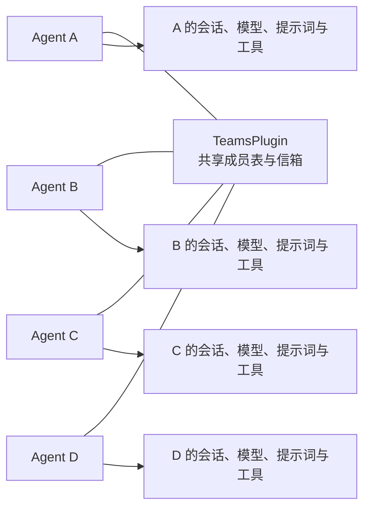

# Teams 设计

长期行为以 [Teams 规范](architecture.md) 为准；本文件解释实现分工与时序。

## 组合



登记保存调用方已创建的 Agent 和 Conversation 引用，不创建代理对象、不复制成员。钩子通过 ctx.plugins 中的 Conversation 引用定位当前成员；工具复用相同定位方式。团队内部不规定父子关系或特权成员。

## 调度状态

每名成员维护一个信箱、接收等待者、当前执行 Outcome、收尾检查计时器、最近自动唤醒覆盖的消息序号，以及可选的后台运行状态。只保存这一份待收消息；会话仍由 Conversation 管理。

```text
发送工具投递
  → 有接收等待者：交付并释放等待计时器
  → 否则入信箱
  → 成员空闲：合并一个后续检查
  → 成员运行中：等本轮收尾检查
```

自动唤醒输入是普通的新输入，不是恢复未完成工具批次。模型可以自然结束；Teams 不向 afterModel 注入调用。每批新消息只覆盖一次真正进入 onRunStart 的唤醒，避免未读消息驱动无限空转。

## 中心邮箱展示

send 入信箱后发布 message-posted；receive 真正取走消息时发布 message-received。直接调用和通信工具走相同路径。订阅者得到观察通知，不能借订阅领取业务消息；网络出口立即编码展示事件，不向调度器回写第二份邮箱。

每名成员各自通过独立 EventPublisherPlugin 发布生成与执行过程，Teams 另行发布邮箱事实。传输与 Web 渲染属于应用 Host，Core 不增加事件回调或 SSE 依赖。

## 收尾事件顺序

```text
Session / 其他插件 onRunEnd（可 await 存储）
  → Teams.onRunEnd 安排 setTimeout(..., 0)，随后返回
  → 可选的 Steering 同步协调尾对象完成运行交接
  → Core 完成 hooks.finish
  → Teams 检查对应 Outcome 是否仍是最近一轮
  → 标为空闲，检查最新信箱
  → 有可唤醒的新消息时调用原 Agent.run
```

计时器是让出当前收尾阶段，不是靠固定毫秒猜测 I/O 完成。Teams 必须位于最后一个拥有异步收尾状态的位置；显式 `after: 'teams'` 的同步协调尾对象可以位于其后。顺序约定由 Teams 初始化核验，不自动重排插件。若同一 Teams 对象出现在多个位置，只在它本轮最后一次收尾回调安排检查，初始化仍由 Core 按对象一次执行。

下一轮 onRunStart 会更换成员的 Outcome 标记；上轮延后回调看到标记变化便退出，不能清空新运行状态。Teams 自己保护成员的初始化、运行和收尾状态，不依赖 Core 私有 active。

## 专家提示词与结果

专家身份使用现有 createSystemPromptPlugin(conversation, prompt)。同一团队对象贡献通信说明，每个 Agent 的不同提示词、模型和工具由装配代码分别选择。示例见 [研究团队](../../examples/research-team.ts)。

调用方拿到的仍是全部真实 Agent 引用，可选择任意成员调用 run 或 stream。某个成员的 run 完成不自动代表全队完成；汇总由提示词中的业务职责和正常发送/接收工具协调。
